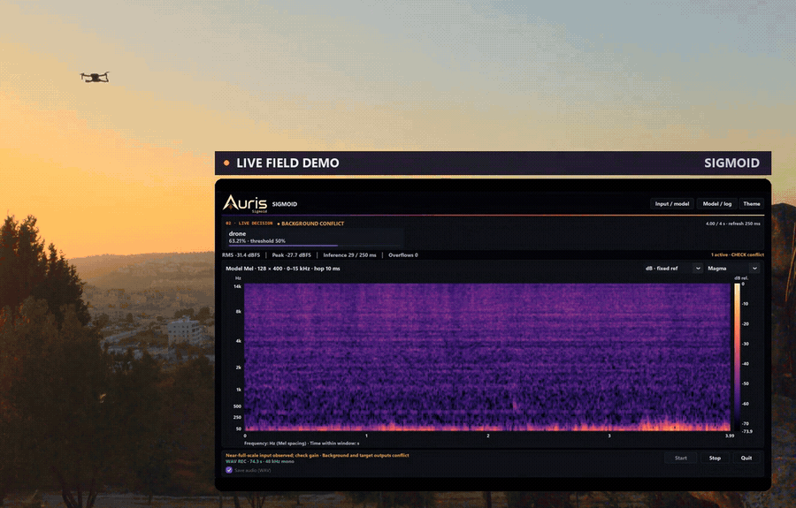
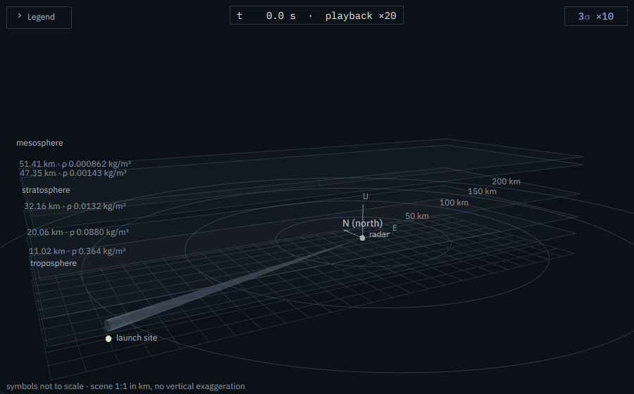
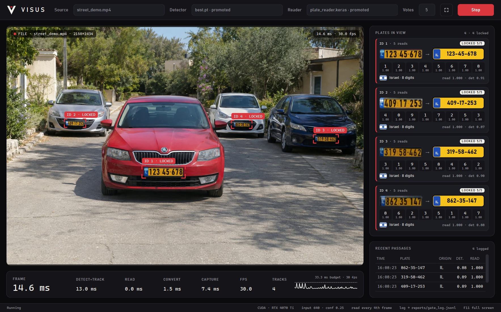
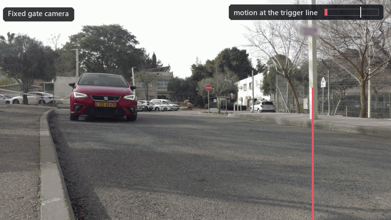

# Jonathan Balulu

**Electrical and Electronics Engineer · Digital Signal Processing · Electro-Optics**

I work mainly in Python, along with C and SystemVerilog. My work spans signal processing, estimation, computer vision and deep learning, RTL design and verification, and validating and integrating hardware and software systems. I enjoy building the whole thing: preparing the data, testing technical choices, evaluating the results and getting it to run in real time.

## Projects

### Real-Time Sound Classification Using Spectrograms and Deep Neural Networks

_Team project · source code not public_

Designed and developed an end-to-end, real-time sound event classification system, including acoustic drone detection, built around an AudioSet-pretrained dynamic CNN. The system converts live audio into log-Mel spectrograms to classify 13 sound categories, with dedicated tools for dataset curation, source tracking, and audio inspection.

**Python · PyTorch · CUDA · CNN · Transfer Learning · Audio DSP · Real-Time Inference · Raspberry Pi**

Live field demo: the drone overhead is detected from its sound alone, in real time.

---

### [Radar Target Tracking with an Extended Kalman Filter](https://github.com/Jonathan-Balulu-Christiansen/EKF_Simulation)

Built a radar tracking simulator from the physics up: a 3-DOF model flies a generic ballistic vehicle through the standard atmosphere, a simulated X-band radar measures range, angles and Doppler, and a 10-state Extended Kalman Filter tracks the flight and estimates its ballistic coefficient. Noise levels are derived rather than tuned, consistency is verified with Monte Carlo NEES/NIS tests, and a live 3D desktop app shows every equation with its numbers.

**Python · NumPy · SciPy · Kalman Filtering · Radar Signal Processing · Monte Carlo · PySide6 · OpenGL**

One full flight played at ×20. The target uses generic, illustrative values.

---

### [Real-Time License Plate Recognition](https://github.com/Jonathan-Balulu-Christiansen/LicensePlateRecognition)

Built a real-time system that detects, tracks and reads Israeli license plates from live cameras and video. A fine-tuned YOLO26m detector and ByteTrack locate and follow each plate, and a CNN+CTC network reads the full number in one pass, with readings voted across frames.

**Python · PyTorch · Keras · YOLO · OpenCV · PySide6 · Computer Vision**

The app running in real time on a synthetic scene. All plate numbers shown are fictional.

---

### [Classical License Plate Reader](https://github.com/Jonathan-Balulu-Christiansen/GatePlateReader)

Built a license plate reader for a fixed gate camera with classical computer vision only. A motion trigger catches each passing car and keeps the sharpest frame of a short burst, Hough lines find the plate's four edges for a perspective warp, and template matching, constrained by the holes in each digit, reads the number.

**Python · OpenCV · NumPy · Image Processing · Computer Vision**

The plate number is fictional: it was replaced in every frame of the clip.

## Contact

[LinkedIn](https://www.linkedin.com/in/jonathan-balulu-christiansen/)
